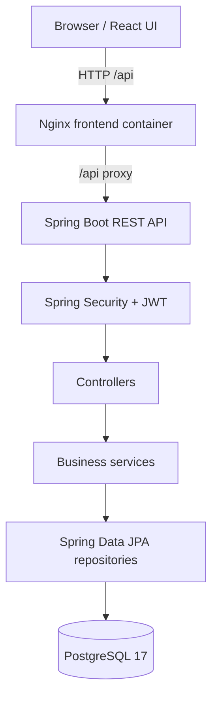

# Blossom E-commerce

**Full Stack Technical Assessment — Java + React**  
**Candidate:** Johan David Garzón Uricoechea  
**Repository:** https://github.com/JDGarzonU/blossom-ecommerce

A functional e-commerce application covering product management, customer authentication, cart-based checkout, inventory updates and order history. The project uses a Spring Boot REST API, PostgreSQL persistence and a responsive React interface. A three-service Docker Compose setup is provided for reproducible local execution.

> **Assessment status (November 16, 2026):** The end-to-end purchase flow was verified locally. The backend test suite reported **64 passed tests**, **98% line coverage**, **97% instruction coverage** and **61% branch coverage**; the JaCoCo 80% line threshold passed. React ESLint and the production build also passed. Refer to [Testing and quality](docs/TESTING.md) and [Evidence](docs/EVIDENCE.md) for details. These figures describe the recorded verification, not a continuous guarantee for future revisions.

## Contents

- [Features](#features)
- [Technology stack](#technology-stack)
- [Architecture](#architecture)
- [Quick start with Docker (recommended)](#quick-start-with-docker-recommended)
- [Running locally without Docker](#running-locally-without-docker)
- [API reference](#api-reference)
- [Roles, authentication and business rules](#roles-authentication-and-business-rules)
- [Automated tests and coverage](#automated-tests-and-coverage)
- [Documentation and screenshots](#documentation-and-screenshots)
- [Decisions and challenges](#decisions-and-challenges)
- [Security and limitations](#security-and-limitations)

## Features

**Customer experience**
- Register and sign in; passwords are hashed with BCrypt, and JWTs are used for authenticated API access.
- Browse product cards, view product details and filter by name, category and price range.
- Add items to a shopping cart, change quantities and remove items.
- Checkout with server-side price/stock validation and view the authenticated user's order history.
- Responsive React interface with form validation, loading and error states.

**Backend and administration**
- Product create/read/update/delete endpoints. Delete is implemented as a **soft delete**, preserving historical order references.
- Role-based permissions (`ADMIN` for product writes, `CUSTOMER` for customer activities).
- Transactional order creation, consolidated quantities, historical unit prices and pessimistic locking for stock updates.
- `User`, `Product`, `Order` and `OrderItem` entities with JPA relationships. Shared audit fields are inherited from `BaseEntity` (`@MappedSuperclass`).
- Swagger/OpenAPI documentation and a centralized REST exception handler.

**Quality and infrastructure**
- Java unit tests with JUnit and Mockito; HTTP/controller and security tests with MockMvc; database integration tests with PostgreSQL 17 via Testcontainers.
- JaCoCo reporting and an enforced 80% minimum **line** coverage check.
- ESLint and Vite production build.
- Multi-stage Docker builds; Nginx reverse proxy for the production-style frontend; PostgreSQL persistent Docker volume.

## Technology stack

| Layer | Technology |
|---|---|
| Backend | Java 17, Spring Boot 4.0.9, Spring MVC, Spring Security |
| Data | PostgreSQL 17, Spring Data JPA, Hibernate, JDBC/HikariCP |
| Authentication | JWT (HS256), BCrypt password hashing, role-based authorization |
| Frontend | React, Vite, React Router, Context API, Axios, CSS, Lucide icons |
| Tests | JUnit, Mockito, MockMvc, Testcontainers (PostgreSQL 17), JaCoCo |
| Documentation | springdoc-openapi / Swagger UI |
| Deployment | Docker Compose, multi-stage Dockerfiles, Nginx |

## Architecture



With Docker Compose, Nginx serves the SPA and proxies `/api` to `backend:8080`; the backend accesses `postgres:5432` on the Compose network. The local-development setup is independent and uses React on `5173`, Spring Boot on `8080`, and a local PostgreSQL instance on `5432`.

**Data model:** `User 1—N Order 1—N OrderItem N—1 Product`. Order items capture quantity, unit price and subtotal. A product's later price changes do not alter the unit price recorded in an existing order. See [Architecture and decisions](docs/ARCHITECTURE.md).

### Repository structure

```text
blossom-ecommerce/
├── backend/
│   ├── src/main/java/com/blossom/ecommerce/
│   │   ├── config/ controller/ dto/ entity/
│   │   ├── exception/ repository/ security/ service/
│   │   └── EcommerceApplication.java
│   ├── src/main/resources/application.properties
│   ├── src/test/
│   ├── Dockerfile
│   ├── pom.xml
│   └── mvnw.cmd / mvnw
├── frontend/
│   ├── src/components/ context/ pages/ services/
│   ├── Dockerfile
│   ├── nginx.conf
│   ├── package.json
│   └── vite.config.js
├── docs/
│   ├── THEORETICAL_ANSWERS.md
│   ├── ARCHITECTURE.md
│   ├── TESTING.md
│   ├── EVIDENCE.md
│   └── evidence/
├── compose.yaml
├── .env.example
└── README.md
```

## Quick start with Docker (recommended)

### Prerequisites

- Docker Desktop (or Docker Engine + Compose plugin) with Linux containers enabled.
- Git and available ports **8082**, **8081** and **5433** on the host.
- Docker must be running. Java, Maven, Node and a local PostgreSQL installation are **not** required for this path.

### 1. Clone and configure

```powershell
git clone https://github.com/JDGarzonU/blossom-ecommerce.git
cd blossom-ecommerce
Copy-Item .env.example .env
```

Open the new root-level `.env`. Set your own values:

```dotenv
BLOSSOM_DB_PASSWORD=<strong-unique-password>
BLOSSOM_JWT_SECRET=<base64-encoded-32-random-byte-secret>
```

**Generate a JWT secret in Windows PowerShell 5.1:**

```powershell
$bytes = New-Object byte[] 32
$rng = [System.Security.Cryptography.RandomNumberGenerator]::Create()
$rng.GetBytes($bytes)
[Convert]::ToBase64String($bytes)
$rng.Dispose()
```

Copy the Base64 output into `.env` (do not paste it in a public issue, screenshot or commit). For macOS/Linux: `openssl rand -base64 32`.

> **Never commit `.env` or real credentials.** The repository includes only `.env.example` placeholders. Keep the database password unchanged once the Docker volume has been initialized; changing the environment variable alone does not reset the password inside an existing PostgreSQL volume.

### 2. Start all services

```powershell
docker compose config --quiet
docker compose up -d --build
docker compose ps
```

| Service | Host address | Role |
|---|---|---|
| Frontend | http://localhost:8082 | React SPA served by Nginx |
| Backend | http://localhost:8081 | Spring Boot API |
| PostgreSQL | `127.0.0.1:5433` | Docker-managed database (`blossom_docker`) |
| API documentation | http://localhost:8081/swagger-ui.html | Swagger UI |
| OpenAPI specification | http://localhost:8081/v3/api-docs | OpenAPI JSON |

The browser should use **http://localhost:8082**; Nginx proxies `/api` to Spring Boot, avoiding a cross-origin dependency in the containerized path.

### 3. Validate the installation

```powershell
docker compose ps
docker compose logs --tail=50 backend
```

Open **http://localhost:8082/api/products**. A successful response may initially be `[]`: the Docker database is intentionally initialized without demo inventory. See **Demo data and permissions** below.

### 4. Stop without losing data

```powershell
docker compose down
```

Data survives in the named `postgres_data` volume. **Avoid `docker compose down -v` unless you explicitly intend to delete the Docker database.**

### Demo data and permissions

Public registration creates a `CUSTOMER` account by design. Product creation requires `ADMIN`; no public admin-registration endpoint is provided.

To demonstrate administration on a fresh **local assessment database only**:

1. Register a sample user with `POST /api/auth/register` (or from the React registration screen), using a unique test email and password.
2. Grant `ADMIN` through a controlled PostgreSQL administrative action in the **local Docker database**:

   ```powershell
   docker compose exec -T postgres psql -U blossom_user -d blossom_docker -c "UPDATE users SET role = 'ADMIN' WHERE email = 'admin@blossom.test' AND role = 'CUSTOMER';"
   ```

   Replace the email if necessary; verify exactly one row changed. This is a **one-time local demo setup step**, not an API or production user-management workflow.
3. Sign in again to generate a new JWT containing `ADMIN` (the old token still contains `CUSTOMER`).
4. In Swagger, click **Authorize**, supply the admin JWT, and call `POST /api/products` with a sample product:

   ```json
   {
     "name": "Mechanical Keyboard RGB",
     "description": "Demo product",
     "price": 189900.00,
     "category": "Peripherals",
     "stock": 15,
     "imageUrl": "https://placehold.co/600x400?text=Keyboard"
   }
   ```

5. Register or log in as a separate `CUSTOMER`, add the product to the cart, place an order, and review **My Orders**. Inventory decreases by the purchased quantity.

## Running locally without Docker

This alternative keeps the backend and frontend in separate development processes and requires **Java 17**, PostgreSQL 17, Node.js with npm, and an IDE or terminal. The Maven Wrapper is included; global Maven installation is optional.

1. Create an empty local PostgreSQL database called `blossom_ecommerce` and a user with appropriate permissions.
2. Set the following environment variables for **the backend process** (e.g. IntelliJ Run Configuration):

   | Variable | Example / use |
   |---|---|
   | `DB_URL` | `jdbc:postgresql://localhost:5432/blossom_ecommerce` (optional if using the default) |
   | `DB_USERNAME` | Local PostgreSQL username (defaults to `postgres` if not overridden) |
   | `DB_PASSWORD` | Local PostgreSQL password **required** |
   | `JWT_SECRET` | Secure 32-byte random key encoded as Base64 **required** |

   The default Java configuration uses the `DB_URL`, `DB_USERNAME` and `DB_PASSWORD` placeholders from `application.properties`. Docker instead injects `SPRING_DATASOURCE_*` environment variables.
3. Start the backend:

   ```powershell
   cd backend
   .\mvnw.cmd spring-boot:run
   ```

   On macOS/Linux use `./mvnw spring-boot:run`. The API serves `http://localhost:8080`.
4. In a separate terminal:

   ```powershell
   cd frontend
   Copy-Item .env.example .env
   npm ci
   npm run dev
   ```

   Confirm `frontend/.env` contains `VITE_API_URL=http://localhost:8080/api`; the app is served at `http://localhost:5173`.

> Start the Java process with environment variables in its **own execution context**. IntelliJ's Run Configuration variables are not automatically exported to independent PowerShell/Maven processes.

## API reference

**Base URLs:** local `http://localhost:8080/api`; Docker host `http://localhost:8081/api`; Docker frontend `/api` via `http://localhost:8082/api`. Full interactive documentation: `/swagger-ui.html` on the backend host.

| Method | Path | Authentication | Description |
|---|---|---|---|
| POST | `/api/auth/register` | Public | Register CUSTOMER; return signed JWT |
| POST | `/api/auth/login` | Public | Validate email/password and return JWT |
| GET | `/api/products` | Public | List/search active products |
| GET | `/api/products/{id}` | Public | Read active product |
| POST | `/api/products` | ADMIN | Create product |
| PUT | `/api/products/{id}` | ADMIN | Update product using a complete request body |
| DELETE | `/api/products/{id}` | ADMIN | Soft-delete product |
| POST | `/api/orders` | Authenticated | Create an order from product IDs and quantities |
| GET | `/api/orders/my-orders` | Authenticated | Return the current user's order history |

Product query parameters: `name`, `category`, `minPrice`, `maxPrice`. Parameters are optional, can be combined, and are implemented with dynamic JPA Specifications. For example:

```http
GET /api/products?name=keyboard&category=Peripherals&minPrice=100000&maxPrice=200000
```

**Registration request:**

```json
{"name":"Demo Customer","email":"customer@example.test","password":"ExamplePass123!"}
```

**Login request:**

```json
{"email":"customer@example.test","password":"ExamplePass123!"}
```

Registration and login responses return `accessToken`, `tokenType`, `userId`, `name`, `email`, and `role`. Send protected calls with `Authorization: Bearer <accessToken>`.

**Order request:**

```json
{"items":[{"productId":1,"quantity":2}]}
```

The server looks up the actual product price, validates stock, records the unit price and subtotal per line, creates the order atomically and decrements stock. An order response includes `id`, `status`, `total`, `createdAt`, and `items`.

**Expected HTTP statuses:** 200 read/update/login; 201 register/create; 204 delete; 400 invalid body or filters; 401 missing/invalid JWT; 403 insufficient permissions; 404 missing or inactive resource; 409 duplicate email or insufficient stock. Security-filter errors may use a different JSON envelope from application-service errors.

> Swagger currently advertises a global Bearer security requirement, so lock icons may appear beside public endpoints. The actual route policy allows public `/api/auth/**` and product GET requests.

## Roles, authentication and business rules

- Passwords are stored using BCrypt hashes, not plaintext.
- Public registration always creates the `CUSTOMER` role; the role cannot be selected in the registration request.
- JWTs are signed using a Base64-configured HS256 secret; the default configured expiration is 120 minutes.
- Product creation, updates and deletion require `ADMIN`.
- Order history derives user ID from the authenticated JWT subject; users cannot choose another customer's ID in a request.
- Product deletion changes `active=false` instead of removing historical references.
- Stock validation and updates are transactional and guarded by pessimistic database locking; duplicate products in an order are consolidated and totals are computed server-side.

## Automated tests and coverage

With Docker Desktop **running** for integration tests:

```powershell
cd backend
.\mvnw.cmd clean verify
```

The full verification runs JUnit, Mockito, MockMvc, security tests, PostgreSQL-based integration tests via Testcontainers, and JaCoCo's mandatory minimum **80% line coverage** check. See [Testing and quality](docs/TESTING.md).

Latest recorded results (November 16, 2026): **64 tests passed, 0 failures, 0 errors, 0 skipped; 98% line coverage, 97% instruction coverage, 61% branch coverage**. The actual JaCoCo value can be regenerated at `backend/target/site/jacoco/index.html` and may change with source edits.

Frontend:

```powershell
cd frontend
npm ci
npm run lint
npm run build
```

Recorded frontend results: ESLint passed without errors; Vite compiled successfully. Frontend unit tests are an optional assessment extra and are **not claimed as implemented**.

## Documentation and screenshots

- [Architecture, data model and design decisions](docs/ARCHITECTURE.md)
- [Testing methodology, coverage and verification](docs/TESTING.md)
- [Theoretical answers — separate assessment document](docs/THEORETICAL_ANSWERS.md)
- [Evidence index and reproducibility notes](docs/EVIDENCE.md)
- [Final submission checklist](docs/DELIVERY_CHECKLIST.md)

See `docs/evidence/` for screenshots captured during the technical assessment. **Demo screenshots show local sample data and are not production records.**

## Decisions and challenges

| Decision or challenge | Resolution / rationale |
|---|---|
| Order-to-product relationship | Introduced `OrderItem` rather than a plain many-to-many association so quantities, historical prices and subtotals can be represented. |
| Inheritance requirement | Used `BaseEntity` with JPA `@MappedSuperclass` for IDs and audit timestamps, avoiding an artificial domain hierarchy. |
| Optional PostgreSQL product filters | Initial JPQL query produced `lower(bytea)` under Hibernate/PostgreSQL with optional null parameters; replaced it with conditional JPA Specifications. |
| Money and inventory | `BigDecimal` for currency; transactional order creation and pessimistic row locking to reduce overselling risk. |
| Authentication | BCrypt + signed JWTs with authorization rules in Spring Security. No public ADMIN registration. |
| Local versus automated test database | Testcontainers launches a temporary PostgreSQL 17 instance, avoiding local password dependencies and cross-test data contamination. |
| Reproducibility | Multi-stage backend/frontend images, Docker Compose, private environment variables and named database volume. |
| Route navigation in Docker | Nginx `try_files` for SPA deep links and `/api` reverse proxy for browser-to-API communication. |
| Quality gate | Mockito + MVC/security + PostgreSQL integration tests; JaCoCo verifies minimum 80% covered lines. |

## Security and limitations

This is a technical assessment and demonstration, not a production-ready commerce platform. In particular:

- There is **no payment gateway**, shipping service or production identity-provider integration.
- There is no public role-administration API or administration UI; admin seeding is a controlled local step.
- Environment secrets must be supplied privately; Docker database credentials should never be committed.
- The current development JPA setup uses `ddl-auto=update`; production deployment should use versioned schema migrations and safer operational configuration.
- Session handling uses a client-side token suitable for the demo; production use should review token refresh, revocation, CSP, XSS protections and secure session architecture.
- JaCoCo branch coverage (61% in the captured report) is lower than line coverage; concurrency, failure-recovery and higher-volume scenarios warrant additional integration testing.
- An intermittent Maven Surefire fork-shutdown warning was observed despite successful test results; this remains an operational point to monitor.
- All ports in Compose are bound to `127.0.0.1` for local assessment use, not exposed publicly.

---

**Technical assessment prepared for Blossom Technologies.**  
**Candidate:** Johan David Garzón Uricoechea  
**Repository:** https://github.com/JDGarzonU/blossom-ecommerce
