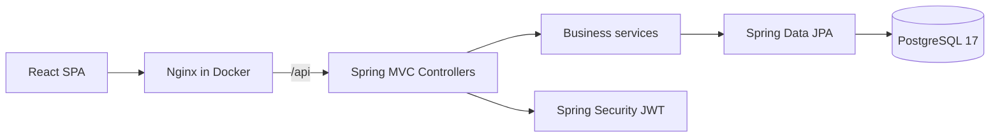
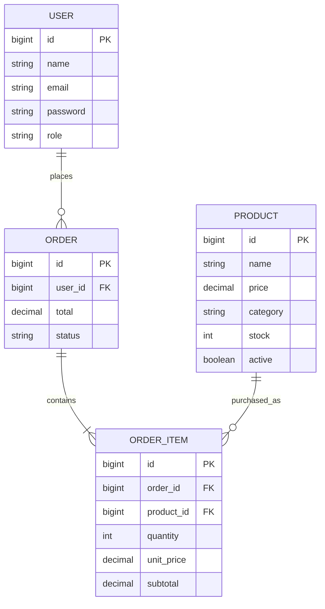
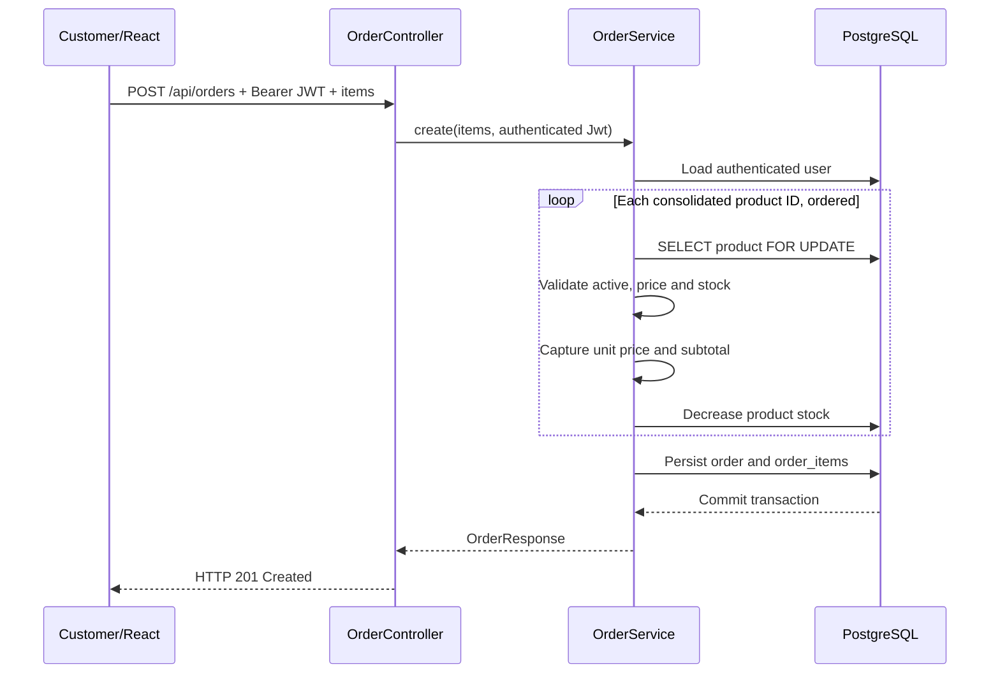

# Architecture and technical decisions

**Blossom E-commerce — Full Stack Java + React assessment**

## 1. System context

The application provides a minimal, complete online-shopping process: account registration and authentication, product discovery, shopping cart checkout, inventory modification and personal order history. The application is split into a React single-page application and a Spring Boot REST API with PostgreSQL persistence.

In local development React runs through Vite at port 5173 and the API at port 8080. Docker Compose publishes the SPA at port 8082, the API at port 8081, and its PostgreSQL instance at port 5433 (host-only binding). Service-to-service addresses inside the Docker network are `backend:8080` and `postgres:5432`.

## 2. Backend responsibilities

| Layer | Typical classes | Responsibility |
|---|---|---|
| Controller | `AuthController`, `ProductController`, `OrderController` | HTTP methods, paths, input validation and status codes |
| DTO | `RegisterRequest`, `ProductRequest`, `CreateOrderRequest`, response records | Explicit API contract; avoid serializing JPA entity graphs |
| Service | `AuthService`, `ProductService`, `OrderService` | Business rules, pricing, availability, user identity and transaction boundaries |
| Repository | `UserRepository`, `ProductRepository`, `OrderRepository` | Persist and query domain entities with JPA |
| Entity | `User`, `Product`, `Order`, `OrderItem`, `BaseEntity` | Relational model, cardinalities and audit fields |
| Security | `SecurityConfig` | JWT validation, password encoding, authorization and CORS |
| Error handling | `GlobalExceptionHandler` | Stable HTTP errors with sensitive implementation details suppressed |
| API docs | `OpenApiConfig` | OpenAPI metadata and JWT Bearer definition |

Spring uses constructor-based dependency injection. Lombok reduces repetitive constructors and accessors. Transaction boundaries belong in the services, not in the HTTP controllers.

## 3. Relational model

**Why `OrderItem`?** The assignment requires one order to contain several products. A simple many-to-many relationship cannot by itself represent the purchased quantity, the historical unit price or line subtotal. `OrderItem` carries that information explicitly. `Order.total` is computed on the server from the lines.

**Why `BaseEntity`?** The requested inheritance example is implemented as a `@MappedSuperclass`, sharing the primary key and audit timestamps (`createdAt`, `updatedAt`) across domain tables without introducing a new physical table.

**Soft delete:** `Product.active` marks catalog availability without breaking foreign keys from historical orders. Catalog search returns active products; order history still references existing product rows.

## 4. Purchase sequence

The request contains product IDs and quantities, not trusted totals. The service consolidates repeated product IDs, processes them in a deterministic order, and takes pessimistic locks. This reduces concurrent overselling and deadlock risk; it does not replace dedicated load and concurrency testing.

## 5. Security decisions

- Public access: registration, login and product read-only endpoints.
- ADMIN role: product POST, PUT and DELETE.
- Authenticated customers: creating orders and reading their own history.
- Public registration always assigns CUSTOMER; role is not accepted from the request.
- Passwords are stored as BCrypt hashes. The JWT uses HS256 and a secret supplied externally via environment variable; the token subject identifies the user.
- The backend extracts the customer ID from the validated JWT for order queries, preventing user-ID injection in order requests.
- Nginx forwards `/api` to the backend on Docker's internal network. Local React (5173) uses explicitly configured CORS.

## 6. Alternative solutions and scope choices

A **modular monolith** was chosen instead of microservices: the assessment concerns a small bounded domain and must remain easy to build, test, explain and run. Context API was chosen instead of Redux because the state is limited to an authenticated session and a shopping cart. Axios centralizes HTTP requests and Bearer token injection. React Router handles SPA navigation. Docker Compose reproduces the three services without requiring local Java/Node/PostgreSQL.

The test suite uses PostgreSQL 17 Testcontainers rather than H2 to avoid database-dialect divergence; isolated JUnit/Mockito tests do not use a database. JaCoCo enforces a line coverage threshold. The observed 61% branch coverage is recorded transparently rather than conflated with line coverage.

## 7. Known limitations and improvements

- `spring.jpa.hibernate.ddl-auto=update` is suitable for this local exercise; versioned SQL migrations would be preferred for production.
- No payment, shipping, customer password reset, password policy service, user provisioning UI or production observability platform is implemented.
- The demo does not provide a public admin-registration flow, by design.
- Security-filter-generated 401/403 bodies are not necessarily identical to the application error-handler envelope.
- The OpenAPI global Bearer requirement currently marks even public operations with a lock icon; permissions are enforced by Spring Security, not by the icon.
- Additional branch and concurrency tests, Hikari/Testcontainers shutdown investigation, token revocation and frontend tests would be worthwhile follow-ups.
