# Evidence of implementation and testing

**Blossom E-commerce — Java + React technical assessment**  
**Candidate:** Johan David Garzón Uricoechea  
**Evidence captured:** November 16, 2026  
**Reference environment:** Windows 10 Pro; Java 17; Spring Boot 4.0.9; PostgreSQL 17; React/Vite; Docker Desktop.

The following screenshots come from the actual local exercise and not from mock UI designs. Authentication screenshots have had visible token/credential values **redacted before inclusion**. Most functional screens use example accounts and sample products; no real customer data is shown. Click any screenshot to view it at full size on GitHub.

## A. Registration and login

| Evidence | What it demonstrates |
|---|---|
| [01 — Registration response](evidence/01-registration-redacted.png) | `POST /api/auth/register` returned HTTP 201 and CUSTOMER role; visible password and JWT redacted |
| [02 — Login response](evidence/02-login-redacted.png) | `POST /api/auth/login` returned HTTP 200 with token metadata and CUSTOMER role; sensitive values redacted |
| [12 — Login UI in Docker](evidence/12-docker-login.png) | React login form served via Nginx at port 8082 |

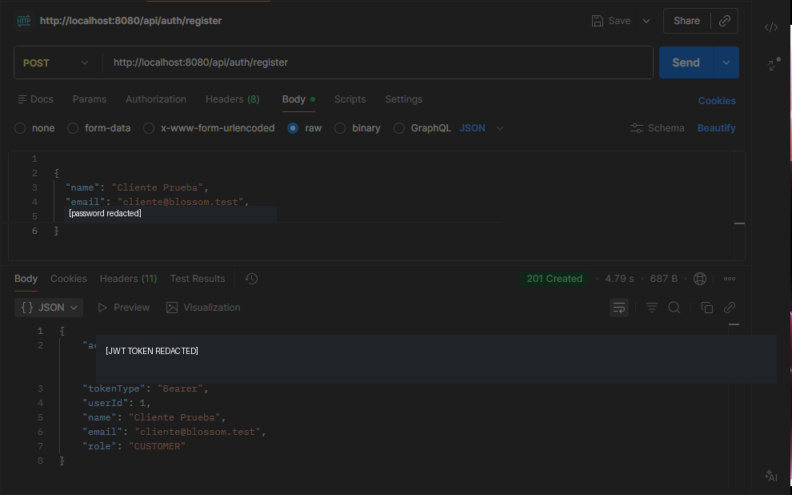

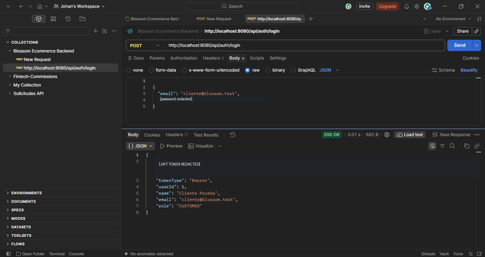

## B. Product browsing and purchase journey

| Evidence | What it demonstrates |
|---|---|
| [03 — Catalog and search controls](evidence/03-catalog.png) | Product listing, category/name/price filters and live catalog entry |
| [04 — Product detail](evidence/04-product-detail.png) | Product information, price, stock and quantity controls |
| [05 — Cart before checkout](evidence/05-cart.png) | Two units in the cart, total 379,800 COP |
| [06 — Order history after checkout](evidence/06-order-history.png) | Created order visible for authenticated user |

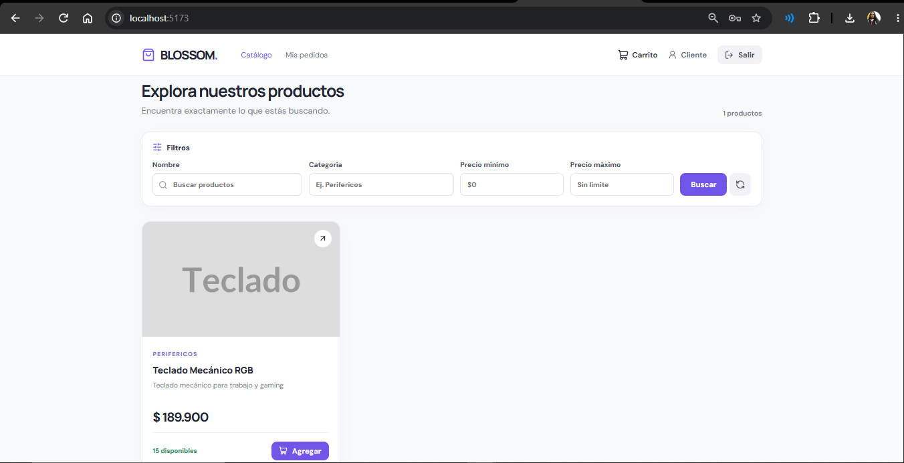

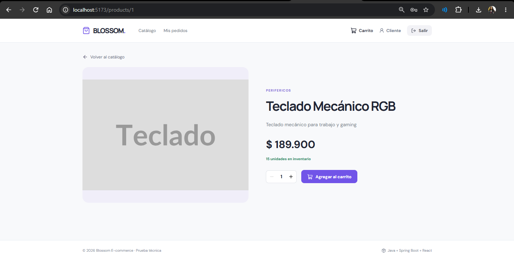

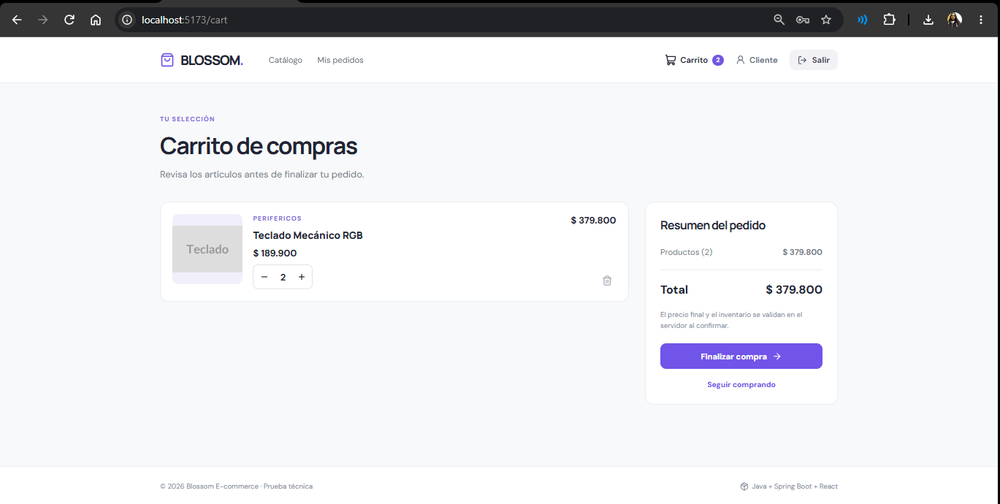

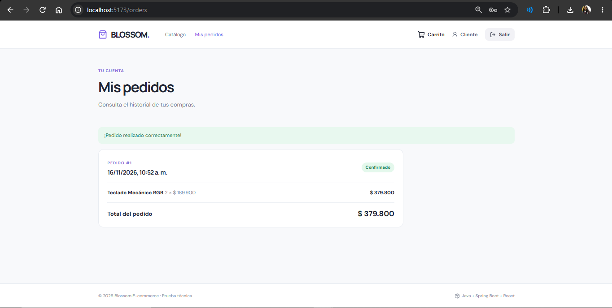

## C. PostgreSQL persistence

| Evidence | Result observed |
|---|---|
| [07 — orders table](evidence/07-orders-database.png) | Order ID 1 for demo customer ID 1, `CREATED`, total `379800.00` |
| [08 — order_items table](evidence/08-order-items-database.png) | Product ID 1, quantity 2, unit price `189900.00`, subtotal `379800.00` |
| [09 — products table](evidence/09-stock-database.png) | Stock 13 after ordering 2 units from initial stock 15 |

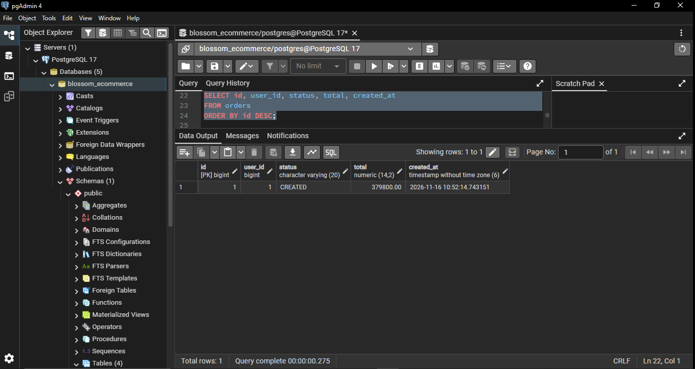

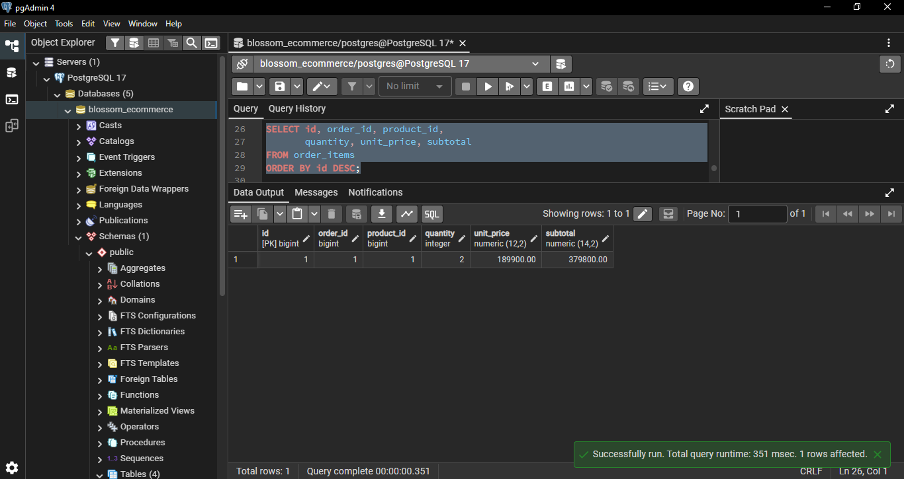

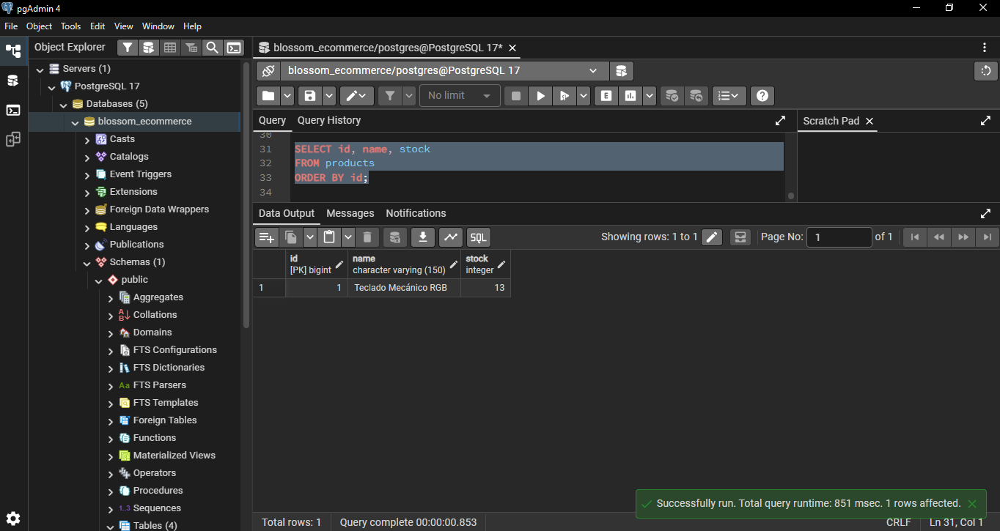

## D. Docker and OpenAPI

| Evidence | What it demonstrates |
|---|---|
| [10 — Docker API response](evidence/10-docker-api.png) | HTTP 200 with an empty array from an isolated Docker PostgreSQL database |
| [11 — Docker frontend](evidence/11-docker-frontend.png) | React SPA successfully served from port 8082 |
| [14 — Swagger UI](evidence/14-swagger-ui.png) | Product, order and auth endpoint list with Bearer scheme |
| [15 — OpenAPI JSON](evidence/15-openapi-spec.png) | Machine-readable `/v3/api-docs` endpoint responds |

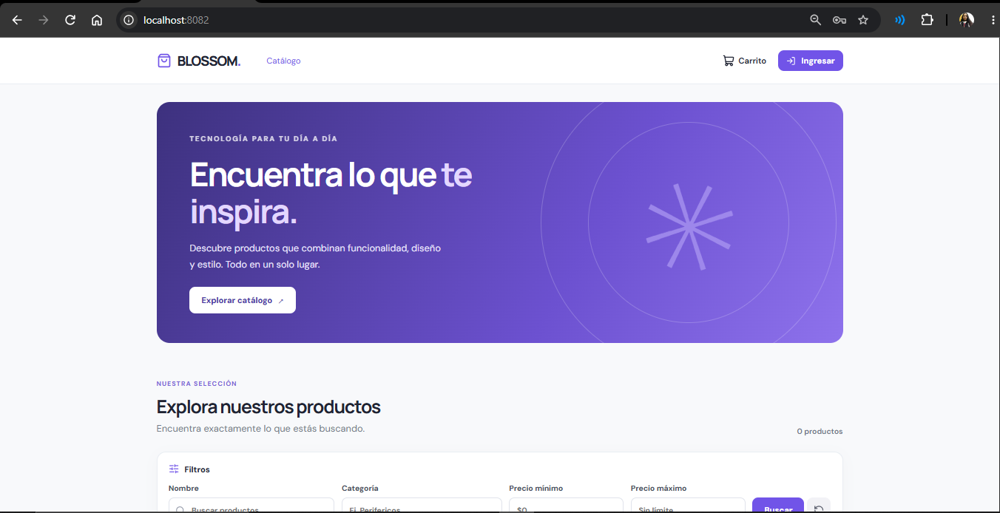

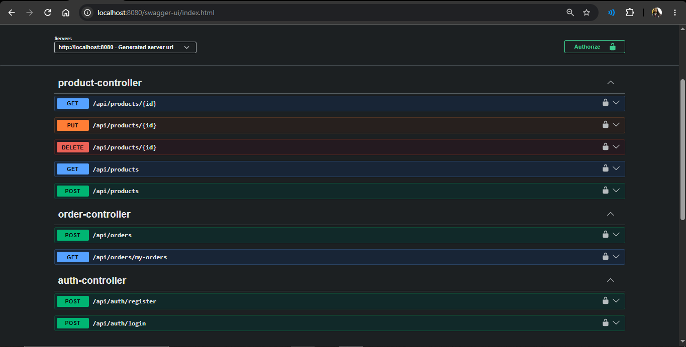

## E. Automated test coverage

| Evidence | Recorded result |
|---|---|
| [13 — JaCoCo](evidence/13-jacoco-coverage.png) | Approx. 97% instruction coverage, 98% line coverage and 61% branch coverage |

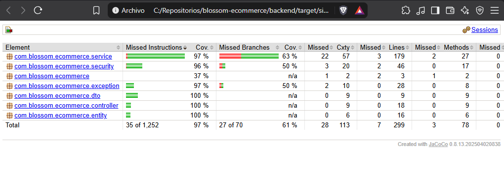

The corresponding Maven build log shared during the assessment reported **64 tests, zero failures, zero errors, zero skipped** and `All coverage checks have been met` from `jacoco:check`. The generated report at `backend/target/site/jacoco/index.html` is deliberately not committed; run `mvn clean verify` to reproduce it.

## F. Acceptance-to-evidence traceability

| Assignment requirement | Implementation / evidence |
|---|---|
| User registration/login | 01, 02, 12; `AuthController`, `AuthService` |
| Product list and search | 03; `ProductController`, `ProductService` Specifications |
| Product detail | 04; `/api/products/{id}` |
| Cart add/remove | 05; React `CartContext` and cart page |
| Create order | 05, 06, 07, 08; `OrderService` |
| Order history | 06, 07; `/api/orders/my-orders` |
| PostgreSQL integration | 07–09; JPA and Testcontainers |
| JWT/roles | Auth flows plus automated `SecurityIntegrationTest` |
| ≥80% backend coverage | 13; JaCoCo 80% line threshold check |
| Docker extra | 10–12; Docker Compose frontend/backend/PostgreSQL |
| Swagger extra | 14–15; OpenAPI and Swagger UI |

## Notes on interpreting the evidence

1. Screenshots document *observed behavior*, not an assertion that every possible edge case was tested manually.
2. Docker database contents were intentionally empty during initial proxy verification; HTTP 200 with `[]` shows connectivity, not sample catalog seeding.
3. Example JWTs and passwords were covered in public-ready screenshots. Never include a live `.env`, a token-bearing browser storage screenshot or secrets from IntelliJ Run Configurations.
4. Browser screenshots contain local time/date and UI text in Spanish; the separate technical documentation is in English because the assignment is in English.
5. The optional React Testing Library/Jest test suite is not part of the recorded implementation.
